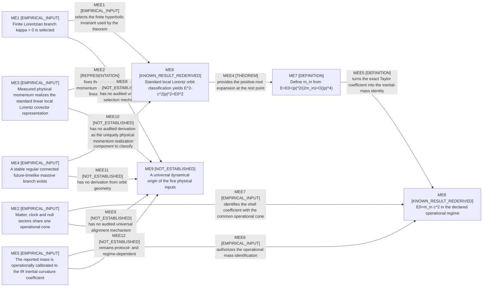

# Terminal dependency DAG

Terminal claim: **E0 = m_in c^2 in the declared operational regime**.

The JSON file is canonical. Every node and every arrow below carries exactly one primary label from the fixed vocabulary; explanatory text does not create a second label.

Allowed labels: `THEOREM`, `DEFINITION`, `REPRESENTATION`, `UNIT_CONVENTION`, `THEORY_CLASS_ASSUMPTION`, `EMPIRICAL_INPUT`, `KNOWN_RESULT_REDERIVED`, `NOT_ESTABLISHED`.

## GLOBAL_POINCARE — Global Poincare route

Global affine Minkowski/Poincare structure is an explicit theory-class input, not a consequence of the Lorentz sector alone.

```mermaid
flowchart LR
  GP1["GP1 [EMPIRICAL_INPUT]<br/>Finite hyperbolic kinematic branch kappa &gt; 0 is physically selected"]
  GP2["GP2 [EMPIRICAL_INPUT]<br/>Matter, clock and null sectors share one cone and normalization"]
  GP3["GP3 [THEORY_CLASS_ASSUMPTION]<br/>Affine Minkowski spacetime with global Poincare semidirect-product action"]
  GP4["GP4 [REPRESENTATION]<br/>Translation generators carry the standard linear Lorentz dual representation"]
  GP5["GP5 [EMPIRICAL_INPUT]<br/>Measured physical momentum realizes that linear representation"]
  GP6["GP6 [EMPIRICAL_INPUT]<br/>A stable future-timelike massive one-particle sector with a rest point exists"]
  GP7["GP7 [THEORY_CLASS_ASSUMPTION]<br/>The selected sector is a connected regular embedded codimension-one orbit component"]
  GP8["GP8 [KNOWN_RESULT_REDERIVED]<br/>Lorentz-orbit classification fixes E^2-c^2|p|^2=E0^2 on that component"]
  GP9["GP9 [DEFINITION]<br/>Observer energy E and spatial momentum p are the declared components of the physical covector"]
  GP10["GP10 [DEFINITION]<br/>Infrared inertial mass is defined by E(p)=E0+|p|^2/(2m_in)+O(|p|^4)"]
  GP11["GP11 [EMPIRICAL_INPUT]<br/>The reported mass m is calibrated to m_in for the declared species and regime"]
  GP12["GP12 [KNOWN_RESULT_REDERIVED]<br/>The positive-branch expansion gives E0=m_in c^2"]
  GP13["GP13 [UNIT_CONVENTION]<br/>Choosing c=1 or the SI decimal value changes only the unit presentation"]
  GP1 -->|"GPE1 [EMPIRICAL_INPUT]<br/>selects the finite Lorentzian sector used by the global construction"| GP3
  GP3 -->|"GPE2 [REPRESENTATION]<br/>fixes the semidirect-product representation of translations"| GP4
  GP4 -->|"GPE3 [EMPIRICAL_INPUT]<br/>is physically identified with measured momentum only by the declared protocol"| GP5
  GP5 -->|"GPE4 [REPRESENTATION]<br/>supplies the physical linear momentum coordinates for the orbit theorem"| GP8
  GP6 -->|"GPE5 [THEORY_CLASS_ASSUMPTION]<br/>requires regularity and connected-component assumptions before classification"| GP7
  GP7 -->|"GPE6 [KNOWN_RESULT_REDERIVED]<br/>permits the standard transitive-orbit classification"| GP8
  GP1 -->|"GPE7 [EMPIRICAL_INPUT]<br/>supplies a real finite Lorentzian quadratic form"| GP8
  GP8 -->|"GPE8 [DEFINITION]<br/>is decomposed in a declared observer frame"| GP9
  GP9 -->|"GPE9 [DEFINITION]<br/>fixes the small-momentum variables used in the IR definition"| GP10
  GP8 -->|"GPE10 [THEOREM]<br/>has the positive-root Taylor coefficient c^2/(2E0)"| GP12
  GP10 -->|"GPE11 [DEFINITION]<br/>identifies that coefficient with 1/(2m_in)"| GP12
  GP11 -->|"GPE12 [EMPIRICAL_INPUT]<br/>authorizes use of the measured mass symbol in this regime"| GP12
  GP2 -->|"GPE13 [EMPIRICAL_INPUT]<br/>identifies the shell coefficient c with the operational common cone"| GP12
  GP13 -->|"GPE14 [UNIT_CONVENTION]<br/>changes the displayed factors but not the dimensionless content"| GP12
```

### Nodes

| ID | Primary label | Statement | Residue key |
|---|---|---|---|
| GP1 | `EMPIRICAL_INPUT` | Finite hyperbolic kinematic branch kappa > 0 is physically selected | `finite_lorentzian_branch` |
| GP2 | `EMPIRICAL_INPUT` | Matter, clock and null sectors share one cone and normalization | `shared_cone` |
| GP3 | `THEORY_CLASS_ASSUMPTION` | Affine Minkowski spacetime with global Poincare semidirect-product action | — |
| GP4 | `REPRESENTATION` | Translation generators carry the standard linear Lorentz dual representation | — |
| GP5 | `EMPIRICAL_INPUT` | Measured physical momentum realizes that linear representation | `linear_physical_momentum` |
| GP6 | `EMPIRICAL_INPUT` | A stable future-timelike massive one-particle sector with a rest point exists | `stable_massive_sector` |
| GP7 | `THEORY_CLASS_ASSUMPTION` | The selected sector is a connected regular embedded codimension-one orbit component | — |
| GP8 | `KNOWN_RESULT_REDERIVED` | Lorentz-orbit classification fixes E^2-c^2\|p\|^2=E0^2 on that component | — |
| GP9 | `DEFINITION` | Observer energy E and spatial momentum p are the declared components of the physical covector | — |
| GP10 | `DEFINITION` | Infrared inertial mass is defined by E(p)=E0+\|p\|^2/(2m_in)+O(\|p\|^4) | — |
| GP11 | `EMPIRICAL_INPUT` | The reported mass m is calibrated to m_in for the declared species and regime | `operational_mass_calibration` |
| GP12 | `KNOWN_RESULT_REDERIVED` | The positive-branch expansion gives E0=m_in c^2 | — |
| GP13 | `UNIT_CONVENTION` | Choosing c=1 or the SI decimal value changes only the unit presentation | — |

### Typed arrows

| ID | From | To | Primary label | Claim |
|---|---|---|---|---|
| GPE1 | GP1 | GP3 | `EMPIRICAL_INPUT` | selects the finite Lorentzian sector used by the global construction |
| GPE2 | GP3 | GP4 | `REPRESENTATION` | fixes the semidirect-product representation of translations |
| GPE3 | GP4 | GP5 | `EMPIRICAL_INPUT` | is physically identified with measured momentum only by the declared protocol |
| GPE4 | GP5 | GP8 | `REPRESENTATION` | supplies the physical linear momentum coordinates for the orbit theorem |
| GPE5 | GP6 | GP7 | `THEORY_CLASS_ASSUMPTION` | requires regularity and connected-component assumptions before classification |
| GPE6 | GP7 | GP8 | `KNOWN_RESULT_REDERIVED` | permits the standard transitive-orbit classification |
| GPE7 | GP1 | GP8 | `EMPIRICAL_INPUT` | supplies a real finite Lorentzian quadratic form |
| GPE8 | GP8 | GP9 | `DEFINITION` | is decomposed in a declared observer frame |
| GPE9 | GP9 | GP10 | `DEFINITION` | fixes the small-momentum variables used in the IR definition |
| GPE10 | GP8 | GP12 | `THEOREM` | has the positive-root Taylor coefficient c^2/(2E0) |
| GPE11 | GP10 | GP12 | `DEFINITION` | identifies that coefficient with 1/(2m_in) |
| GPE12 | GP11 | GP12 | `EMPIRICAL_INPUT` | authorizes use of the measured mass symbol in this regime |
| GPE13 | GP2 | GP12 | `EMPIRICAL_INPUT` | identifies the shell coefficient c with the operational common cone |
| GPE14 | GP13 | GP12 | `UNIT_CONVENTION` | changes the displayed factors but not the dimensionless content |

## FIBERWISE_LOCAL_SHELL — Fiberwise/local-shell route

No global translations, globally conserved energy or global Poincare group are required; the result is pointwise and observer-relative.

```mermaid
flowchart LR
  FL1["FL1 [EMPIRICAL_INPUT]<br/>Finite local Lorentzian cone rather than Galilean or elliptic kinematics is physically realized"]
  FL2["FL2 [EMPIRICAL_INPUT]<br/>Relevant sectors share the local cone and its operational normalization"]
  FL3["FL3 [THEORY_CLASS_ASSUMPTION]<br/>A time-oriented Lorentzian cotangent fiber and future observer are declared"]
  FL4["FL4 [REPRESENTATION]<br/>Physical momentum is represented as a standard linear Lorentz covector; in gauge backgrounds it is kinetic momentum"]
  FL5["FL5 [EMPIRICAL_INPUT]<br/>The measured momentum is empirically identified with that kinetic covector"]
  FL6["FL6 [EMPIRICAL_INPUT]<br/>A stable future-timelike massive local shell with a rest point exists"]
  FL7["FL7 [THEORY_CLASS_ASSUMPTION]<br/>The selected shell is connected, regular, embedded, boundaryless and codimension one"]
  FL8["FL8 [KNOWN_RESULT_REDERIVED]<br/>Fiberwise Lorentz-orbit classification fixes g^-1(pi,pi)=E0(x)^2/c^2"]
  FL9["FL9 [DEFINITION]<br/>Observer decomposition defines E_u=pi(u) and measured spatial momentum p_u"]
  FL10["FL10 [DEFINITION]<br/>Infrared inertial mass is defined by the quadratic coefficient at the rest point"]
  FL11["FL11 [EMPIRICAL_INPUT]<br/>The reported mass m is calibrated to the local m_in in the declared regime"]
  FL12["FL12 [KNOWN_RESULT_REDERIVED]<br/>Local positive-branch expansion gives E0(x)=m_in(x)c^2"]
  FL1 -->|"FLE1 [EMPIRICAL_INPUT]<br/>selects the real finite Lorentzian local geometry"| FL3
  FL3 -->|"FLE2 [REPRESENTATION]<br/>provides the standard local covector representation"| FL4
  FL4 -->|"FLE3 [EMPIRICAL_INPUT]<br/>becomes physical only after operational identification"| FL5
  FL5 -->|"FLE4 [REPRESENTATION]<br/>supplies the physical momentum coordinate acted on linearly"| FL8
  FL6 -->|"FLE5 [THEORY_CLASS_ASSUMPTION]<br/>requires explicit shell-regularity hypotheses"| FL7
  FL7 -->|"FLE6 [KNOWN_RESULT_REDERIVED]<br/>permits the local single-orbit conclusion"| FL8
  FL1 -->|"FLE7 [EMPIRICAL_INPUT]<br/>supplies the local Lorentzian invariant"| FL8
  FL8 -->|"FLE8 [DEFINITION]<br/>is decomposed relative to the declared observer"| FL9
  FL9 -->|"FLE9 [DEFINITION]<br/>defines the variables used in the IR coefficient"| FL10
  FL8 -->|"FLE10 [THEOREM]<br/>fixes the positive-root Taylor series"| FL12
  FL10 -->|"FLE11 [DEFINITION]<br/>identifies the quadratic coefficient with inertial mass"| FL12
  FL11 -->|"FLE12 [EMPIRICAL_INPUT]<br/>links the measured mass label to m_in"| FL12
  FL2 -->|"FLE13 [EMPIRICAL_INPUT]<br/>identifies the local shell cone with the common operational c"| FL12
```

### Nodes

| ID | Primary label | Statement | Residue key |
|---|---|---|---|
| FL1 | `EMPIRICAL_INPUT` | Finite local Lorentzian cone rather than Galilean or elliptic kinematics is physically realized | `finite_lorentzian_branch` |
| FL2 | `EMPIRICAL_INPUT` | Relevant sectors share the local cone and its operational normalization | `shared_cone` |
| FL3 | `THEORY_CLASS_ASSUMPTION` | A time-oriented Lorentzian cotangent fiber and future observer are declared | — |
| FL4 | `REPRESENTATION` | Physical momentum is represented as a standard linear Lorentz covector; in gauge backgrounds it is kinetic momentum | — |
| FL5 | `EMPIRICAL_INPUT` | The measured momentum is empirically identified with that kinetic covector | `linear_physical_momentum` |
| FL6 | `EMPIRICAL_INPUT` | A stable future-timelike massive local shell with a rest point exists | `stable_massive_sector` |
| FL7 | `THEORY_CLASS_ASSUMPTION` | The selected shell is connected, regular, embedded, boundaryless and codimension one | — |
| FL8 | `KNOWN_RESULT_REDERIVED` | Fiberwise Lorentz-orbit classification fixes g^-1(pi,pi)=E0(x)^2/c^2 | — |
| FL9 | `DEFINITION` | Observer decomposition defines E_u=pi(u) and measured spatial momentum p_u | — |
| FL10 | `DEFINITION` | Infrared inertial mass is defined by the quadratic coefficient at the rest point | — |
| FL11 | `EMPIRICAL_INPUT` | The reported mass m is calibrated to the local m_in in the declared regime | `operational_mass_calibration` |
| FL12 | `KNOWN_RESULT_REDERIVED` | Local positive-branch expansion gives E0(x)=m_in(x)c^2 | — |

### Typed arrows

| ID | From | To | Primary label | Claim |
|---|---|---|---|---|
| FLE1 | FL1 | FL3 | `EMPIRICAL_INPUT` | selects the real finite Lorentzian local geometry |
| FLE2 | FL3 | FL4 | `REPRESENTATION` | provides the standard local covector representation |
| FLE3 | FL4 | FL5 | `EMPIRICAL_INPUT` | becomes physical only after operational identification |
| FLE4 | FL5 | FL8 | `REPRESENTATION` | supplies the physical momentum coordinate acted on linearly |
| FLE5 | FL6 | FL7 | `THEORY_CLASS_ASSUMPTION` | requires explicit shell-regularity hypotheses |
| FLE6 | FL7 | FL8 | `KNOWN_RESULT_REDERIVED` | permits the local single-orbit conclusion |
| FLE7 | FL1 | FL8 | `EMPIRICAL_INPUT` | supplies the local Lorentzian invariant |
| FLE8 | FL8 | FL9 | `DEFINITION` | is decomposed relative to the declared observer |
| FLE9 | FL9 | FL10 | `DEFINITION` | defines the variables used in the IR coefficient |
| FLE10 | FL8 | FL12 | `THEOREM` | fixes the positive-root Taylor series |
| FLE11 | FL10 | FL12 | `DEFINITION` | identifies the quadratic coefficient with inertial mass |
| FLE12 | FL11 | FL12 | `EMPIRICAL_INPUT` | links the measured mass label to m_in |
| FLE13 | FL2 | FL12 | `EMPIRICAL_INPUT` | identifies the local shell cone with the common operational c |

## MINIMAL_EMPIRICAL — Minimal empirical route

This graph intentionally removes global Poincare, RG, spin-2, conformal-setting and photon-cycle mechanisms; it retains only the irreducible physical premises plus the known local orbit/IR bridge.

### Nodes

| ID | Primary label | Statement | Residue key |
|---|---|---|---|
| ME1 | `EMPIRICAL_INPUT` | Finite Lorentzian branch kappa > 0 is selected | `finite_lorentzian_branch` |
| ME2 | `EMPIRICAL_INPUT` | Matter, clock and null sectors share one operational cone | `shared_cone` |
| ME3 | `EMPIRICAL_INPUT` | Measured physical momentum realizes the standard linear local Lorentz covector representation | `linear_physical_momentum` |
| ME4 | `EMPIRICAL_INPUT` | A stable regular connected future-timelike massive branch exists | `stable_massive_sector` |
| ME5 | `EMPIRICAL_INPUT` | The reported mass is operationally calibrated to the IR inertial curvature coefficient | `operational_mass_calibration` |
| ME6 | `KNOWN_RESULT_REDERIVED` | Standard local Lorentz orbit classification yields E^2-c^2\|p\|^2=E0^2 | — |
| ME7 | `DEFINITION` | Define m_in from E=E0+\|p\|^2/(2m_in)+O(\|p\|^4) | — |
| ME8 | `KNOWN_RESULT_REDERIVED` | E0=m_in c^2 in the declared operational regime | — |
| ME9 | `NOT_ESTABLISHED` | A universal dynamical origin of the five physical inputs | — |

### Typed arrows

| ID | From | To | Primary label | Claim |
|---|---|---|---|---|
| MEE1 | ME1 | ME6 | `EMPIRICAL_INPUT` | selects the finite hyperbolic invariant used by the theorem |
| MEE2 | ME3 | ME6 | `REPRESENTATION` | fixes the physical momentum variables and linear action |
| MEE3 | ME4 | ME6 | `EMPIRICAL_INPUT` | supplies the physical orbit component to classify |
| MEE4 | ME6 | ME7 | `THEOREM` | provides the positive-root expansion at the rest point |
| MEE5 | ME7 | ME8 | `DEFINITION` | turns the exact Taylor coefficient into the inertial-mass identity |
| MEE6 | ME5 | ME8 | `EMPIRICAL_INPUT` | authorizes the operational mass identification |
| MEE7 | ME2 | ME8 | `EMPIRICAL_INPUT` | identifies the shell coefficient with the common operational cone |
| MEE8 | ME1 | ME9 | `NOT_ESTABLISHED` | has no audited universal selection mechanism |
| MEE9 | ME2 | ME9 | `NOT_ESTABLISHED` | has no audited universal alignment mechanism |
| MEE10 | ME3 | ME9 | `NOT_ESTABLISHED` | has no audited derivation as the uniquely physical momentum realization |
| MEE11 | ME4 | ME9 | `NOT_ESTABLISHED` | has no derivation from orbit geometry |
| MEE12 | ME5 | ME9 | `NOT_ESTABLISHED` | remains protocol- and regime-dependent |

## Exact intersection of unavoidable physical inputs

For each graph, collect residue_key from nodes with unavoidable_physical_input=true and primary_label=EMPIRICAL_INPUT; take the exact set intersection.

- `finite_lorentzian_branch`
- `shared_cone`
- `linear_physical_momentum`
- `stable_massive_sector`
- `operational_mass_calibration`

The intersection contains no theorem, definition, representation convention or unit convention. It is therefore the irreducible empirical residue of this audit, not a new mechanism.
